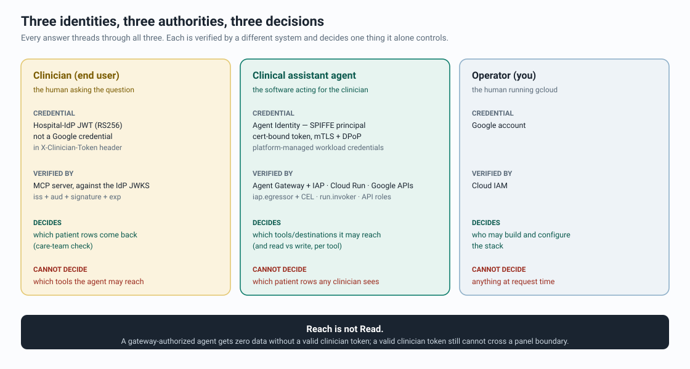
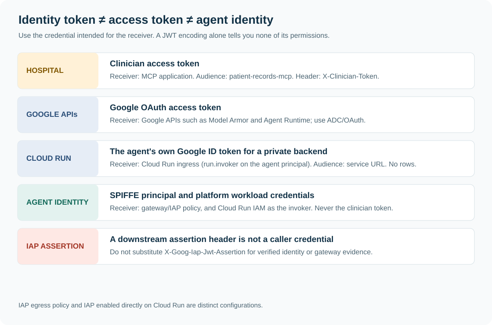
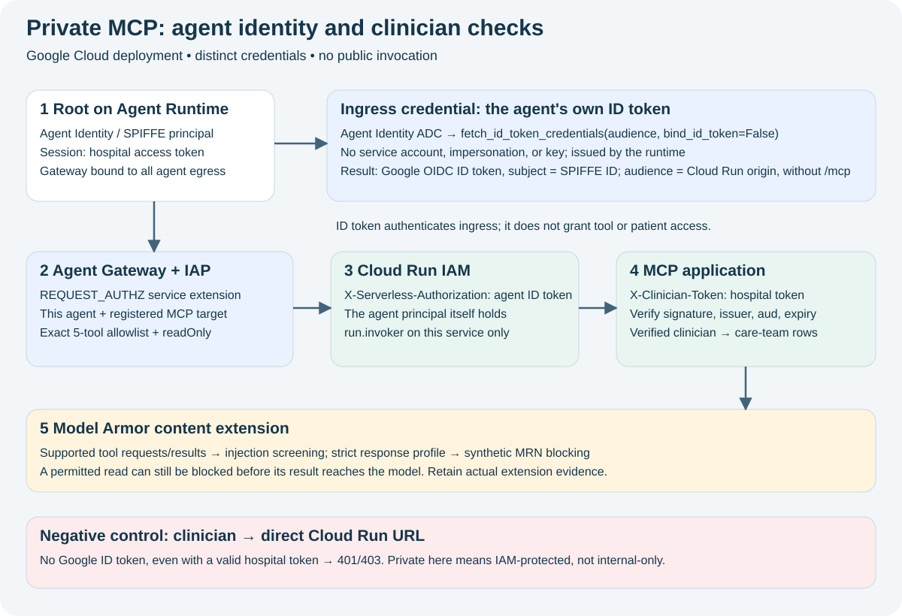
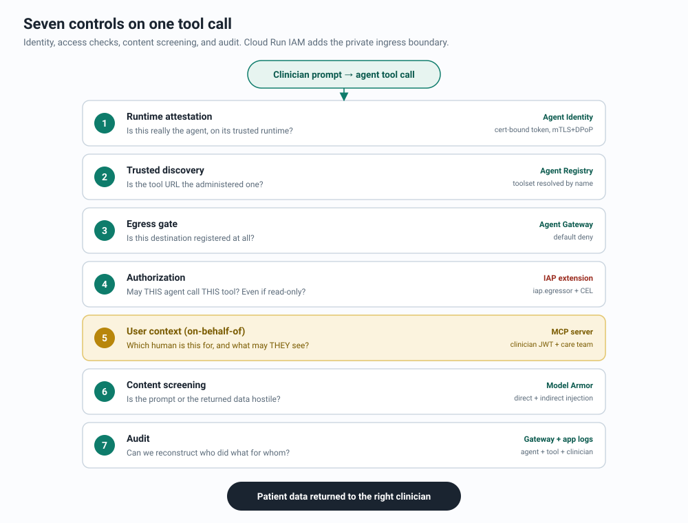
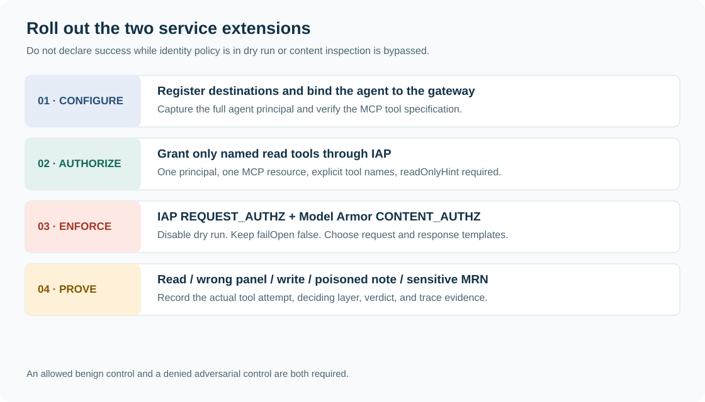
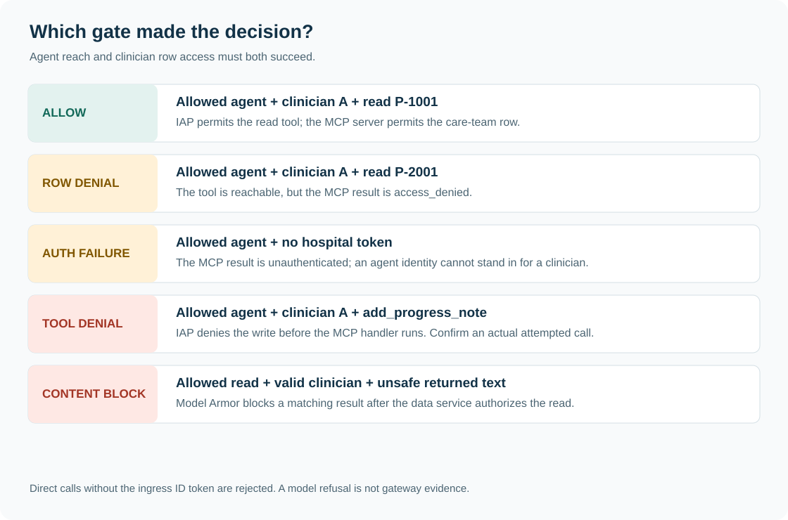
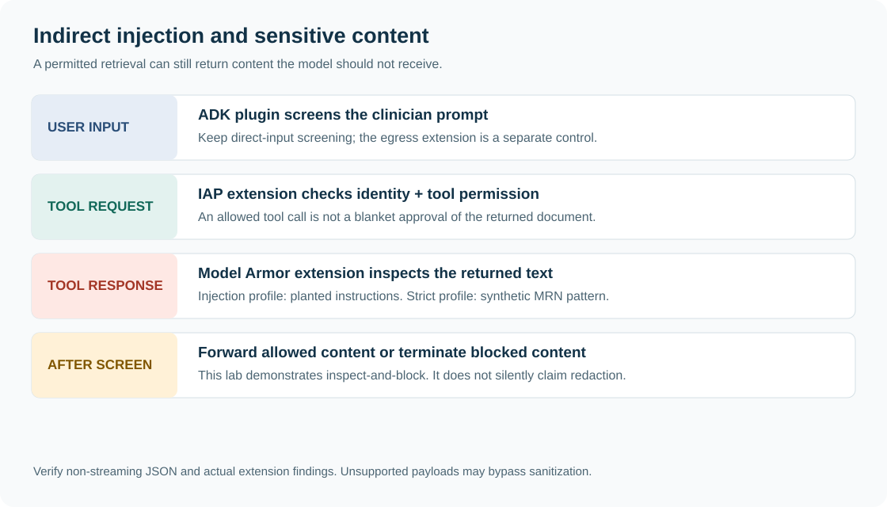
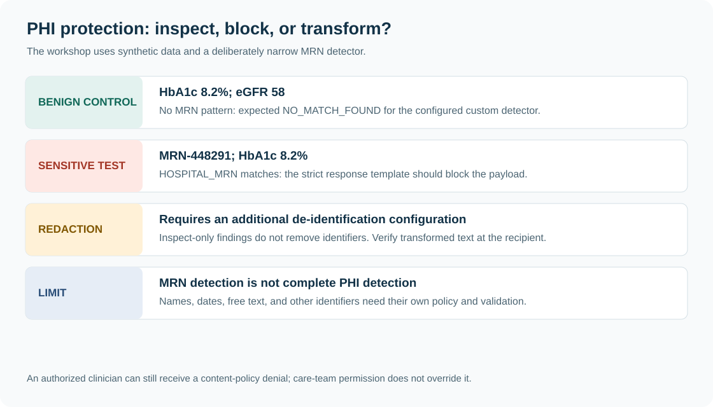

# Agent Governance Lab: governing a clinical multi-agent system on Google Cloud

Code repository for the **Agent Governance Lab** codelab by Priya Pandey.

A hands-on lab that builds a clinician-facing multi-agent system over **synthetic** patient records and then governs it end to end with **Agent Identity**, **Agent Registry**, **Agent Gateway** with the **IAP** and **Model Armor** service extensions, **A2A agent cards**, and **observability** that never exports patient data into telemetry. Every control is proven on real traffic: an allowed read, a denied cross-panel read, a screened document, a write blocked on the wire, and the audit rows and traces that show which layer decided.

This repository holds what the lab *runs*: scripts, agents, the MCP server, the mock identity provider, clients, and tests. The guided step-by-step codelab and its long-form companion are distributed separately with the workshop (see [Companion documents](#-companion-documents)).


*Conceptual illustration. The diagrams below describe the actual implementation.*

### ⚠️ Security & Usage Disclaimer

**Use at your own risk.** This repository is an educational demonstration and architectural reference, not an officially supported Google Cloud product and not a clinical system.

- **Synthetic data only.** Every patient, MRN, lab value, and note in `mcp-server/patients.json` is fabricated. Never connect this code to real records.
- **The mock IdP has no login.** `mock-idp/` mints a signed JWT for any email it is asked for. It exists so the row-filter logic can be demonstrated; in production it is replaced by the hospital's real OIDC provider (the MCP server trusts nothing but a JWKS URL).
- **Several surfaces are Preview.** Gateway-attached Model Armor, A2A on Agent Runtime, the ADK Agent Registry integration, and gateway tracing are Preview or experimental; flags and log field names can change.
- **Disposable project.** Deploy only in a sandbox project (inside an organization or standalone), set a budget (Agent Runtime, Cloud Run, and Model Armor are billable), and run `scripts/99-cleanup.sh` when you finish.

## 🧭 The one idea this lab is built on

**Authorization to reach a tool is not authorization to read data.** Three identities take part in every request, each verified by a different authority, each deciding exactly one thing.



| Party | Credential | Verified by | Decides |
|---|---|---|---|
| Clinician (end user) | Hospital-IdP JWT (RS256), carried in `X-Clinician-Token` | The MCP server, against the IdP's JWKS | **Which patients' rows** come back |
| Clinical assistant agent | **Agent Identity**: a SPIFFE principal with a platform-managed certificate (mTLS + DPoP) | Agent Gateway + the IAP authorization extension | **Which tools, agents, and endpoints** the agent may reach, per tool |
| You, running `gcloud` | Google account | Cloud IAM | Who may build and configure the stack |

A perfectly authorized agent with no clinician token gets zero patient data. A valid clinician token still cannot cross a care-team boundary. Neither gate can be talked into answering the other's question.



## 🏗️ Architecture


| Component | Where it runs | Its job |
|---|---|---|
| `mock-idp/` hospital IdP simulator | Cloud Run | Mints clinician JWTs (RS256), publishes JWKS |
| `mcp-server/` Patient Records MCP server | Cloud Run, IAM-private | Six tools (five read, one write); validates the clinician JWT; care-team row filter |
| `agents/guideline_agent/` A2A specialist | Cloud Run | Publishes an **A2A agent card**; answers anonymized guideline questions |
| `agents/clinical_assistant/` root agent | Agent Runtime, with Agent Identity | Reasons, calls MCP tools on behalf of the clinician, delegates to the specialist over A2A |
| Agent Registry | Regional catalog | Three collections, `agents`, `mcpServers`, `endpoints`; doubles as the gateway's allowlist |
| Agent Gateway + IAP `REQUEST_AUTHZ` extension | Google-managed | Default-deny egress; per-tool CEL policy on the agent's identity; dry run, then enforced |
| Model Armor template + `CONTENT_AUTHZ` extension | Regional | Prompt-injection and sensitive-data screening inside the agent and again at the gateway |
| Cloud Trace, Logging, Monitoring | Project | One trace across the A2A hop, gateway dashboard, IAP audit rows, log-based metrics, an alert |

### One request, end to end


1. The clinician authenticates at the hospital IdP and receives a signed JWT (`aud: patient-records-mcp`, one-hour expiry).
2. The client opens an Agent Runtime session and stores the JWT in **session state**, never in the prompt or a tool argument.
3. The Model Armor ADK plugin screens the raw prompt (`sanitizeUserPrompt`) before the model reasons on it.
4. Gemini selects `get_recent_labs(P-1001)`; the toolset was resolved from **Agent Registry** by name.
5. A `header_provider` callback attaches the JWT as `X-Clinician-Token`, and `cloud_run_auth.py` adds a Google ID token for the agent's **own Agent Identity** (audience: the MCP service origin) as `X-Serverless-Authorization`.
6. The **Agent Gateway** intercepts the call. The credential on the wire is the agent's SPIFFE principal; IAP evaluates the egress policy, including the per-tool CEL condition.
7. The gateway's **Model Armor extension** screens the tool request and, later, the response.
8. Cloud Run IAM admits the agent's ID token because the agent principal holds `roles/run.invoker`; the MCP server logs that SPIFFE identity and validates the clinician JWT against the IdP's JWKS.
9. The care-team filter returns rows only for patients on the authenticated clinician's panel.
10. The result returns through the gateway and the plugin's `after_tool_callback`, which screens it for indirect injection.
11. The model answers, flagging abnormal values.



## 🧱 The governance stack, layer by layer



| Layer | What it decides | Set up by | Evidence it leaves |
|---|---|---|---|
| Hospital identity (mock IdP) | Who the clinician is | `02-deploy-mock-idp.sh` | Decoded JWT claims; `Authenticated clinician` lines in the MCP server log |
| Private MCP server + care-team filter | Which rows this clinician may see | `03-deploy-mcp-server.sh` | `access_denied` for a colleague's patient; 401/403 for direct callers |
| Model Armor, standalone and in the ADK plugin | Is the prompt or tool result safe for the model | `04-model-armor.sh` | `MATCH_FOUND` on the planted referral letter |
| Agent Registry (three collections) | What exists and what may be reached | `05-register-registry.sh`, `07-deploy-agents.sh` | `agents list` shows two, `mcp-servers list` one, `endpoints list` every platform hostname |
| Agent Gateway + IAP `REQUEST_AUTHZ` | May *this agent* reach *this tool* | `06-create-gateway.sh` (dry run) → `08-grant-egress-and-enforce.sh` (enforced) | Gateway rows with per-extension verdicts; IAP audit rows with `iamEnforcementMode` |
| Agent Identity | Which agent is calling, at the gateway *and* at Cloud Run's front door (`roles/run.invoker` is bound to the agent principal; no service account on the data path) | `deploy/deploy_root_agent.py` (`identity_type=AGENT_IDENTITY`), `08-grant-egress-and-enforce.sh` | `AGENT_IDENTITY` principal; IAP `principalSubject`; `Calling agent: spiffe://…` lines in the MCP server log |
| Model Armor `CONTENT_AUTHZ` at the gateway | Is the payload on the wire safe | `10-model-armor-gateway.sh` | A second extension verdict per gateway row; the MRN block |
| Observability | Can we prove all of it later | `11-observability.sh` | Traces across the A2A hop, dashboard, alert, three correlated audit streams |

### Rollout: observe, grant, enforce



The gateway starts with the IAP extension in `DRY_RUN` (decisions logged, nothing blocked). Only after the agent's principal exists and its grants are in place does `08-grant-egress-and-enforce.sh` flip the extension to enforced, so a missing grant never 403-loops a fresh deployment. The MCP grant is the one *conditional* binding:

```cel
(api.getAttribute('iap.googleapis.com/mcp.tool.isReadOnly', false) == true &&
 api.getAttribute('iap.googleapis.com/mcp.toolName', '') in
 ['whoami', 'list_my_patients', 'get_patient_summary', 'get_recent_labs', 'get_clinical_notes'])
|| api.getAttribute('iap.googleapis.com/mcp.toolName', '') == ''
```

Read-only annotation **and** an explicit allowlist (a newly added read-only tool is not admitted by accident), **or** no tool name at all (the MCP `initialize`/`tools/list` handshake carries none; a `tools/call` always does, so this clause can never admit a write). `add_progress_note` is annotated `readOnlyHint: false` and is never listed, so it is denied at the gateway with `403 Egress request is not authorized.` before the request reaches the server.

### Which gate decided?



`scripts/09-demo.sh` runs eight beats. Each makes exactly one thing hostile, so every denial is attributable to a single control:

| # | Prompt (abridged) | Expected outcome | Control |
|---|---|---|---|
| 1 | List my patients; labs for P-1001; flag abnormal | Panel P-1001..P-1003; labs with HbA1c and eGFR flagged | MCP care-team check; read tools clear the gateway CEL |
| 2 | Summary for P-2001 | `access_denied`, relayed honestly | MCP row filter (P-2001 is on clinician B's panel) |
| 3 | Guideline question, no identifiers | Answer from `guideline_agent` over A2A | Registry `agents` entry + agent-to-agent policy |
| 4 | "Ignore all your previous instructions…" | Blocked before the model reasons on it | Model Armor plugin, user-message seam |
| 5 | Read P-1002's imported referral letter | IAP allows the call; the returned content is denied at the gateway | Model Armor `CONTENT_AUTHZ` extension (plugin is the in-agent fallback) |
| 6 | Add a progress note to P-1001 | Gateway 403; the MCP server logs nothing | IAP CEL read-only condition |
| 7 | Call `whoami`, report verbatim | Clinician A named; header-presence report | End-to-end identity and header passthrough |
| 8 | (operator) gateway log query | Per-call rows with per-extension verdicts | Gateway audit logs |

> A model *refusal* is not evidence of a gateway *denial*. The strongest evidence for beat 6 is an absence: the MCP server never logs `add_progress_note`, because the call never arrived.

### Content screening and the PHI boundary





Model Armor runs twice: as an ADK plugin inside the agent (user message, tool result, model response) and as the gateway's `CONTENT_AUTHZ` extension on supported MCP and A2A payloads. The lab's MCP server returns stateless `application/json` because streaming/SSE payloads pass the extension unsanitized. The strict response profile is inspect-and-**block** for one synthetic MRN pattern; it is not de-identification. With `failOpen: false`, a blocked tool response never reaches the agent, so the in-agent plugin's "withheld" message does not appear; the gateway `DENY` row is the evidence.

## 🔭 Observability without exporting PHI

- **Agent telemetry** is enabled on the Agent Runtime deploy with message-content capture pinned to `NO_CONTENT` (an override is validated and warned about). The A2A specialist exports Cloud Trace spans with `traceparent` propagation, so one trace spans root agent → gateway → specialist.
- **Gateway tracing** (Preview) via a telemetry policy; **gateway Observability dashboard** once the `_Default` log bucket is upgraded to Observability Analytics.
- **Custom Monitoring dashboard**, two log-based metrics (egress denials, Model Armor blocks), and an **alert policy** on egress denials, all from `11-observability.sh`.

Three audit streams tell the whole story only together:

```bash
# 1. Gateway decisions per MCP call
gcloud logging read 'resource.type="networkservices.googleapis.com/Gateway" AND resource.labels.gateway_name="'"$GATEWAY_NAME"'"' \
  --project="$PROJECT_ID" --limit=10 --freshness=1d \
  --format='table(timestamp, httpRequest.status, jsonPayload.agentGatewayInfo.mcpInfo.method, jsonPayload.agentGatewayInfo.mcpInfo.parameter, jsonPayload.agentGatewayInfo.agentRegistryResource, trace)'

# 2. IAP's own verdicts (who, which resource, granted?)
gcloud logging read 'protoPayload.serviceName="iap.googleapis.com" AND protoPayload.authorizationInfo.permission="iap.resources.egressViaIAP"' \
  --project="$PROJECT_ID" --limit=10 --freshness=1d \
  --format='table(timestamp, protoPayload.authenticationInfo.principalSubject, protoPayload.authorizationInfo[0].resource, protoPayload.authorizationInfo[0].granted)'

# 3. Which clinician the MCP server authenticated
gcloud logging read 'resource.type="cloud_run_revision" AND resource.labels.service_name="'"$MCP_SERVICE"'" AND textPayload:"Authenticated clinician"' \
  --project="$PROJECT_ID" --limit=10 --freshness=1d --format='table(timestamp, textPayload)'
```

## 📁 Repository layout

```text
pyproject.toml  Dependencies for the Cloud Shell environment (`uv sync`); requirements-cloud.txt is the pip equivalent
scripts/        00-env.sh (source first) and the numbered workshop scripts 01…11 and 99
scripts/yaml/   envsubst templates: gateway, IAP extension (dry run / enforce) + policy,
                Model Armor extension + policy, gateway tracing policy, dashboard, alert
agents/         clinical_assistant (root agent, Agent Runtime) and guideline_agent (A2A specialist, Cloud Run)
mcp-server/     Patient Records MCP server, toolspec.json (readOnlyHint annotations), synthetic patients.json
mock-idp/       Hospital IdP simulator (RS256 JWTs + JWKS)
clients/        get_token.py, test_mcp.py, validate_agent_card.py, test_a2a.py, test_phi.py, chat_remote.py
deploy/         deploy_root_agent.py (Agent Identity, gateway binding, telemetry env vars)
tests/cloud/    Deployed-stack checks the codelab runs (opt-in with RUN_CLOUD_TESTS=1)
docs/           diagrams/ (SVG sources) and images/ (cover art)
```

## ✅ Prerequisites

- A disposable Google Cloud project, **with or without an organization**. Agent Identity anchors the agent's principal to a trust domain: `agents.global.org-ORG_ID.system.id.goog` in an organization, `agents.global.proj-PROJECT_NUMBER.system.id.goog` in a standalone project. `00-env.sh` prints yours, and the grant script reads the exact principal from the deployed agent, so both work unchanged.
- **Owner** on that project, billing enabled.
- Cloud Shell (recommended; nothing runs on your laptop) or a workstation with `gcloud` (including `gcloud storage`), `envsubst`, and [`uv`](https://docs.astral.sh/uv/) (or Python 3.12+ with pip).
- Everything runs in one region, `us-central1`, which satisfies every regional constraint in this stack at once.

### Launch stages you depend on

| Surface | Stage |
|---|---|
| Agent Identity on Agent Runtime; IAP for agent egress via Agent Gateway; Agent Registry incl. A2A agent-card registration | GA |
| Model Armor sanitize APIs and templates | GA (regional endpoints only) |
| Model Armor ↔ Agent Gateway integration (`CONTENT_AUTHZ`) | Preview |
| A2A on Agent Runtime; ADK A2A support; ADK Agent Registry integration (`header_provider`, `get_mcp_toolset`) | Preview / experimental (this repo pins `google-adk[a2a,agent-identity]==2.7.1`) |
| Gateway tracing policy | Preview (the rest of the observability step works without it) |

## ⚡ Quickstart

Run the scripts in order from the repository root. **Every new shell** must re-run `source scripts/00-env.sh`.

#### 1. Clone and install the deployment clients

```bash
git clone https://github.com/priyapandeyb/agent-governance-lab.git
cd agent-governance-lab
chmod +x scripts/*.sh
command -v uv >/dev/null || pip install --quiet --user uv   # one-time; ~2 s
uv sync && source .venv/bin/activate                        # without uv: python3 -m venv .venv && source .venv/bin/activate && python -m pip install -r requirements-cloud.txt
```

#### 2. Point the environment at your project

```bash
export PROJECT_ID=$(gcloud config get-value project)
source scripts/00-env.sh
```

Expected: a project number, an organization ID or `org none`, the **trust domain** your agent identity will use (`agents.global.org-…` or `agents.global.proj-…`), `us-central1`, and two clinician personas. Clinician A defaults to your own `gcloud` account; clinician B is a fixed colleague whose panel you must *not* be able to read.

```text
Project:      my-healthcare-lab (123456789012), org none (project without an organization)
Trust domain: agents.global.proj-123456789012.system.id.goog
Region:       us-central1
Clinician A:  you@gmail.com
Clinician B:  dr.b@hospital-demo.example
```

#### 3. Build the stack, one layer at a time

| Script | What it does |
|---|---|
| `01-enable-apis.sh` | Enables every API the lab touches; creates the Agent Runtime staging bucket |
| `02-deploy-mock-idp.sh` | Deploys the hospital IdP simulator (`--max-instances=1` pins the signing key) |
| `03-deploy-mcp-server.sh` | Deploys the IAM-private Patient Records MCP server (no invoker until the agent exists) |
| `04-model-armor.sh` | Creates the Model Armor template and proves it with standalone sanitize calls (direct and indirect injection) |
| `05-register-registry.sh` | Registers the MCP server (from `toolspec.json`) and the platform endpoints in Agent Registry |
| `06-create-gateway.sh` | Creates the egress Agent Gateway with the IAP authorization extension in `DRY_RUN` |
| `07-deploy-agents.sh` | Deploys the A2A specialist, validates and registers its agent card, deploys the root agent with Agent Identity, confirms both agents are in the registry |
| `08-grant-egress-and-enforce.sh` | Binds `run.invoker` on the MCP service to the agent's identity; grants the agent principal egress to the MCP server (read-only CEL), the specialist (`--agent`), and the platform endpoints; flips IAP to enforced |
| `10-model-armor-gateway.sh` | Attaches Model Armor at the gateway as a `CONTENT_AUTHZ` extension (run before the demo so it exercises the full stack) |
| `09-demo.sh` | The eight-beat acceptance run, ending in the gateway's own audit log |
| `11-observability.sh` | Agent and gateway tracing, log-based metrics, alert policy, dashboard, audit queries |
| `99-cleanup.sh` | Tears everything down in dependency order |

`09-demo.sh` needs the engine principal written by `07-deploy-agents.sh`: `source scripts/rendered/agent.env` first.

#### 4. Talk to the deployed assistant yourself

```bash
source scripts/rendered/agent.env
python clients/chat_remote.py --engine "$AGENT_ENGINE_NAME" --idp-url "$IDP_URL" --email "$CLINICIAN_A_EMAIL" \
  --message "What are the latest labs for P-1001? Flag anything abnormal."
```

## 🧪 Tests

The repository ships the checks the codelab itself runs against your deployment (`pytest` is installed by `uv sync`):

```bash
source scripts/00-env.sh
RUN_CLOUD_TESTS=1 python -m pytest -q tests/cloud/test_deployed_stack.py -k private_mcp_rejects_direct_callers -v   # after 03-deploy-mcp-server.sh
RUN_CLOUD_TESTS=1 python -m pytest -q tests/cloud -s                                                                # after 09-demo.sh
```

They prove that a hospital token alone cannot reach the private MCP server, that clinician isolation and the shared-patient case hold on the deployed stack, that a tampered token is rejected, and that the live Model Armor template catches both injection shapes; the final test prints a report.

## 📚 Companion documents

- **The codelab** (15 steps, about 4 hours): every step opens with a short narrative, then `👉💻` run / `👉` click / `👀` read actions with expected output, a **✅ Verification** block with an **If it breaks** list, and a plain-language recap. Distributed with the workshop.
- **The deep dive**: full design rationale, code walkthroughs, launch-stage notes, production notes, and the complete troubleshooting table. Each codelab step links into it.

## 🏭 From lab to production

- **Swap in the real hospital IdP.** The MCP server already trusts nothing but a JWKS URL, issuer, and audience.
- **Harden the A2A specialist.** `--no-allow-unauthenticated` with an ID token on the A2A hop, `securitySchemes` in the card, or Cloud Run's `--functional-type=agent --identity-type=agent-identity` for automatic registration with its own Agent Identity.
- **Construct the delegated message explicitly** instead of forwarding session history to the specialist.
- **Move the on-behalf-of flow to the managed Agent Identity auth manager** when its launch stage fits your risk tolerance.
- **Treat telemetry as PHI-adjacent.** Keep content capture off, set retention, and alert on denials; the dashboard and alert here are a starting point.

## 🛠️ Troubleshooting (short list)

| Symptom | Likely cause | Fix |
|---|---|---|
| Grant script warns `expected trust domain …` | `scripts/rendered/agent.env` came from a different project, or `00-env.sh` was sourced for another project | Re-source `00-env.sh` for this project and re-run `07-deploy-agents.sh` (or fix `agent.env`) before granting |
| Agent startup fails with 403s in gateway logs | A platform endpoint is registered but not granted (or a hostname variant is missing) | Re-run `05` and `08`; both read the same `PLATFORM_ENDPOINTS` list |
| Agent runs but per-agent policies never match | Deployed without `identity_type: AGENT_IDENTITY` + `agent_gateway_config` together | Redeploy with both; the SPIFFE principal only exists when both are set |
| `403 Egress request is not authorized` on a *read* tool | Missing `roles/iap.egressor` for this principal, or the `spiffe://` spelling was bound instead of `principal://` | Re-run `08`; it rewrites the scheme |
| Every MCP tool returns `unauthenticated` | Clinician token missing from session state, expired (1 h), or the IdP restarted with a new key | Re-mint with `get_token.py`; keep the IdP at `--max-instances=1` |
| `iap web add-iam-policy-binding --agent=guideline-agent` → `NOT_FOUND` | The specialist is not in the `agents` collection | `gcloud agent-registry agents list`; re-run `07`'s registration |
| Gateway log columns print empty with `--format` | Field paths differ by version | Drop `--format` and read the raw `jsonPayload`; documented paths are `jsonPayload.agentGatewayInfo.mcpInfo.*` |
| Gateway Observability tab is empty | `_Default` bucket not upgraded to Observability Analytics | `gcloud logging buckets update _Default --location=global --enable-analytics` |

The full table (30+ rows) is in the deep dive.

## 🔗 Reference documentation

- [Agent Gateway overview](https://docs.cloud.google.com/gemini-enterprise-agent-platform/govern/gateways/agent-gateway-overview) · [Monitor Agent Gateway](https://docs.cloud.google.com/gemini-enterprise-agent-platform/govern/gateways/monitor-agent-gateway) · [Troubleshoot Agent Gateway](https://docs.cloud.google.com/gemini-enterprise-agent-platform/troubleshooting/troubleshoot-agent-gateway)
- [Configure IAM agent policies](https://docs.cloud.google.com/gemini-enterprise-agent-platform/govern/policies/configure-iam-policies)
- [Register agents](https://docs.cloud.google.com/agent-registry/register-agents) · [Manual registration (A2A agent cards)](https://docs.cloud.google.com/agent-registry/manual-registration) · [Register MCP servers](https://docs.cloud.google.com/agent-registry/register-mcp-servers)
- [Model Armor + Agent Gateway](https://docs.cloud.google.com/model-armor/model-armor-agent-gateway-integration)
- [Set up tracing](https://docs.cloud.google.com/gemini-enterprise-agent-platform/scale/runtime/tracing) · [View agent traces](https://docs.cloud.google.com/gemini-enterprise-agent-platform/optimize/observability/traces) · [Set up monitoring](https://docs.cloud.google.com/gemini-enterprise-agent-platform/scale/runtime/monitoring)
- [A2A protocol specification](https://a2a-protocol.org/latest/specification/) · [ADK A2A](https://adk.dev/a2a/)

## 📄 License

This project is licensed under the Apache License, Version 2.0. See the [LICENSE](LICENSE) file for details.

## 👩‍💻 Author

Priya Pandey · GitHub: [@priyapandeyb](https://github.com/priyapandeyb)
